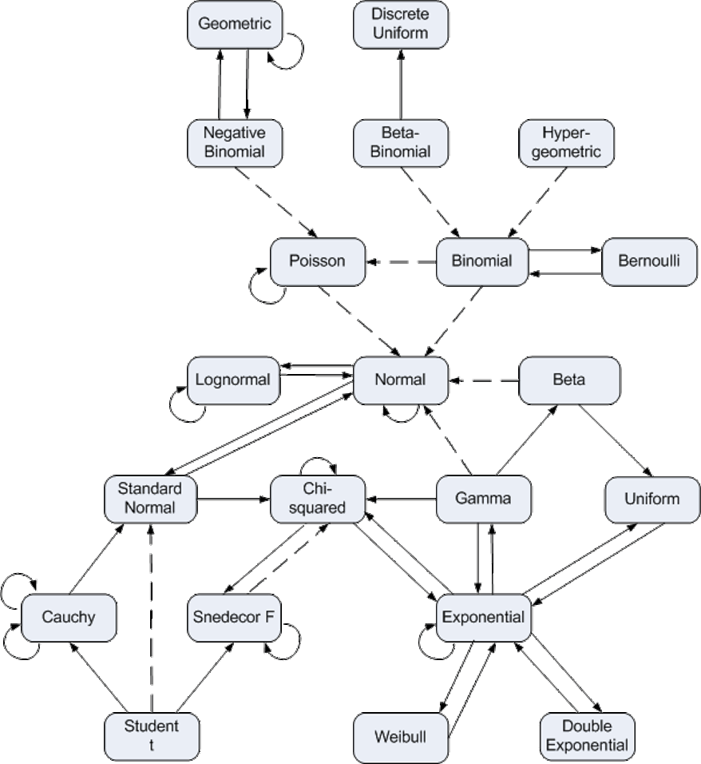
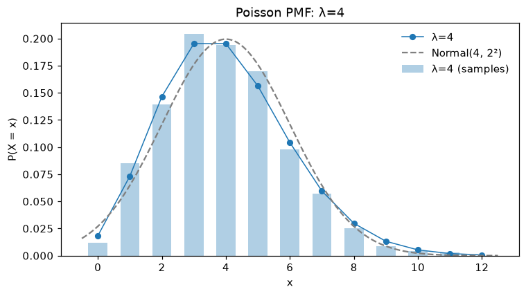
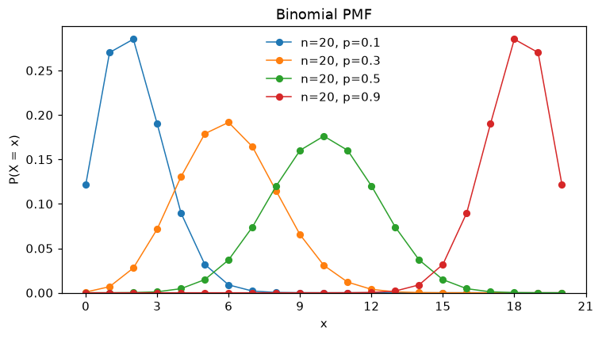
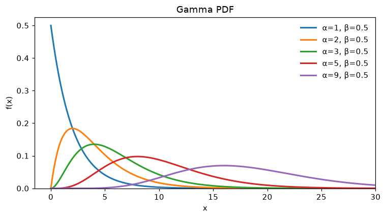

# probability_distributions

Probability distributions with everything you need to know about them in one object: the **story**,
**parameter space**, **support**, **PMF/PDF**, **CDF**, **mean**, **variance**, **MGF**, **use cases** and
**special facts**, plus **sampling** and (interactive) **PMF/PDF/CDF plots**.

```python
from probability_distributions import Distribution

d = Distribution("binomial", n=20, p=0.3)
d.info()          # print everything below
d.plot()          # PMF, with a slider for p (and a box for n) when displayed interactively
d.sample(5)       # array([...])
```

## How the distributions relate



*Chart credit: John D. Cook, [Diagram of distribution relationships](https://www.johndcook.com/blog/distribution_chart/).
Solid lines are transformations or special cases; dashed lines are limits.*

For a great interactive reference, see the [Probability Distribution Explorer](https://distribution-explorer.github.io/index.html).

## Installation

```bash
pip install -e .                  # numpy, scipy, matplotlib
pip install -e ".[interactive]"   # + ipywidgets, for sliders in Jupyter
pip install -e ".[dev]"           # + pytest
```

## Creating a distribution

```python
Distribution("normal", mu=0, sigma=2)
Distribution("normal", 0, 2)        # positional, in the order of d.param_names
Distribution("normal")              # every parameter has a default (here μ=0, σ=1)
Distribution("standard_normal")     # aliases: "gaussian", "chi2", "t", "negbin", "double_exponential", ...
Distribution("gamma", k=2, theta=3) # alternative parameterization: shape k, scale θ → α = 2, β = 1/3
```

Each distribution has one canonical parameterization (the names in the table below, shown by
`d.param_names`), but common alternatives are accepted as keywords and converted: e.g. `shape`/`k`/`rate`/
`scale`/`theta` for the Gamma, `scale` for the Exponential, `sd`/`variance` for the Normal, `df` for the t and
chi-squared, `loc`/`scale` for location–scale families, and scipy's names where they differ. `d.info()` lists
them under "Also accepts". Rates are canonical where there's a Poisson-process story (Exponential λ, Gamma β), so
that Exponential(λ) = Gamma(1, λ) and both share λ with the Poisson.

| Discrete | Continuous | Multivariate |
|---|---|---|
| `bernoulli(p)` | `uniform(a, b)` | `multinomial(n, p)` |
| `binomial(n, p)` | `normal(mu, sigma)` | `multivariate_normal(mu, cov)` |
| `hypergeometric(N, K, n)` | `exponential(lam)` — rate (or `scale=`) | `dirichlet(alpha)` |
| `geometric(p)` — trials incl. the success | `gamma(alpha, beta)` — shape, rate (or `k=`, `theta=`) | |
| `geometric_failures(p)` — failures only | `beta(alpha, beta)` | |
| `negative_binomial(r, p)` | `weibull(k, lam)` | |
| `poisson(lam)` | `pareto(alpha, xm)` | |
| `discrete_uniform(a, b)` | `cauchy(x0, gamma)` | |
| `beta_binomial(n, alpha, beta)` | `student_t(nu)` | |
| `categorical(p)` | `chi_squared(k)` | |
| | `f(d1, d2)` (Snedecor F) | |
| | `logistic(mu, s)` | |
| | `gumbel(mu, beta)` | |
| | `laplace(mu, b)` | |
| | `lognormal(mu, sigma)` | |

`probability_distributions.available()` lists the names (optionally `available("discrete")`, etc.).
For `categorical`/`multinomial`, if `p` sums to less than 1 the last category gets the remainder.

Parameters are readable as attributes (`d.p`), as a dict (`d.params`), and changeable with
`d.set_params(p=0.5)` or `d.copy(p=0.5)`. Invalid values raise a `ValueError`.

## Information

| Method | Returns |
|---|---|
| `pmf(x)` / `pdf(x)` | P(X = x) / f(x). With no argument, the formula. They are aliases: calling `pmf` on a continuous (or `pdf` on a discrete) distribution logs a warning and evaluates the right one. |
| `cdf(x)` | F(x) = P(X ≤ x), or the formula |
| `mgf(t)` | M(t) = E[e^(tX)] (closed form, or numerical where there is none; `nan` + warning where it doesn't exist), or the formula |
| `expected_value()` / `variance()` / `std()` | Numbers for the current parameters (`formula=True` for the formula). Mean vector / covariance matrix for multivariate. |
| `parameter_space()` / `support()` | Strings; `support()` also shows the support for the current parameters. `support_bounds()` gives numbers. |
| `story()` / `use_cases()` / `special_facts()` | The generative story, applications, and relationships to other distributions |
| `info()` | Prints all of the above (`describe()` returns it as a string) |
| `scipy` | The underlying frozen `scipy.stats` object |

```text
>>> Distribution("poisson", lam=4).info()
Poisson(λ=4)  —  discrete
────────────────────────────────────────────────────────────
Story:            Count the events in a fixed window of time or space when events happen
                  independently at a constant average rate, e.g. emails per hour or chocolate chips
                  per cookie. It is the count of many rare, independent opportunities for an event.
Parameters:       • λ = expected number of events in the window (rate × window length)  [here: 4]
Also accepts:     mu, mean (= lam)
Parameter space:  λ > 0
Support:          x ∈ {0, 1, 2, …}   (here: {0, 1, …})
PMF:              P(X = x) = λ^x e^(−λ) / x!
CDF:              F(x) = e^(−λ) Σ_{i=0}^{⌊x⌋} λ^i / i! = Q(⌊x⌋ + 1, λ)  (regularized upper
                  incomplete gamma)
Mean:             λ  =  4
Variance:         λ  =  4
MGF:              M(t) = exp(λ(e^t − 1))
Use cases:        • Counts: arrivals, decays, mutations, typos per page, calls per hour.
                  • Poisson regression for count data.
Special facts:    • Limit of Binomial(n, p) as n → ∞, p → 0 with np = λ fixed.
                  • Variance = mean = λ.
                  ...
```

## Sampling

```python
d.sample()                          # one value (a vector for multivariate distributions)
d.sample(1000, seed=0)              # array of shape (1000,)  — (1000, k) for multivariate
d.sample(1000, out="samples.txt")   # also write one sample per line to a text file
```

## Plotting

```python
d.plot()                            # PMF for discrete, PDF for continuous
d.plot("cdf", out="cdf.pdf")        # save (format from the extension)
d.plot(samples=1000, plot_normal=True)              # overlay a histogram of samples and a Normal approximation
d.plot(samples=data, y="count", bins=30)            # your own data, in counts instead of fractions
d.plot(xmin=0, xmax=50, ylog=True, dark=True, style="bar", title="...")
```



Options (shared by `Distribution.plot` and `utils.plot`):

| Option | Meaning |
|---|---|
| `type` | `"pmf"`/`"pdf"` (aliases, with a warning on a mismatch) or `"cdf"` |
| `out` | File to save to (`None` = don't save) |
| `xmin`, `xmax`, `ymin`, `ymax` | Axis limits (a sensible x range is chosen automatically) |
| `xlog`, `ylog` | Log-scale axes |
| `samples` | An int (draw that many) or your data: overlaid as a histogram / empirical CDF |
| `y` | `"fraction"` (default) or `"count"` (needs `samples`; theory is scaled to expected counts) |
| `bins` | Histogram bins for continuous samples |
| `style` | Discrete only: `"line"`, `"bar"` or `"stem"` |
| `plot_normal` | `True` = Normal with the same mean/sd, or `(mu, sigma)` |
| `color`/`label` (`colors`/`labels` for `utils.plot`), `title`, `xlabel`, `ylabel`, `legend_loc`, `figsize`, `dpi` | Styling |
| `dark` | matplotlib's `dark_background` style |
| `ax`, `show` | Draw into existing axes; whether to call `plt.show()` |

Multivariate distributions are drawn in 3-D: `multinomial` with k = 3 categories, `dirichlet` with k = 3
components, and `multivariate_normal` in 2 dimensions.

### Interactive parameters

When a plot is displayed (not saved) in Jupyter (with `ipywidgets`) or in a matplotlib GUI window, each
parameter gets a control: a **slider** if it lives in a bounded range (like p ∈ [0, 1]) and a **text box**
otherwise (like n or σ; vectors/matrices are typed as `0.2, 0.5, 0.3` / `1, 0.5; 0.5, 1`). Moving a control
updates the distribution's parameters in place, so `d.params` holds the values you ended up with.

```python
d = Distribution("normal")
d.plot(sliders={"mu": (-5, 5), "sigma": (0.1, 5)})   # force sliders with your own ranges
d.plot(interactive=False)                             # plain static plot
```

### Several distributions in one plot

```python
from probability_distributions import Distribution, utils

utils.plot([Distribution("binomial", n=20, p=p) for p in (0.1, 0.3, 0.5, 0.9)])
utils.plot([Distribution("gamma", alpha=a, beta=0.5) for a in (1, 2, 3, 5, 9)], xmax=30, out="gamma.png")
utils.plot([Distribution("binomial", n=50, p=0.5), Distribution("normal", mu=25, sigma=12.5 ** 0.5)],
           labels=["Binomial", "Normal approximation"])
```

 

Warnings (pmf/pdf mismatches, MGFs that don't exist, ...) go through the `logging` logger named
`probability_distributions`.

## Development

```bash
pip install -e ".[dev]"
pytest
```

The tests check, among other things, that every closed-form MGF matches E[e^(tX)] computed numerically and
that M′(0) equals the mean. The original exploratory notebook is `plot_probability_distributions.ipynb`.

## License

MIT — see [LICENSE](LICENSE).
